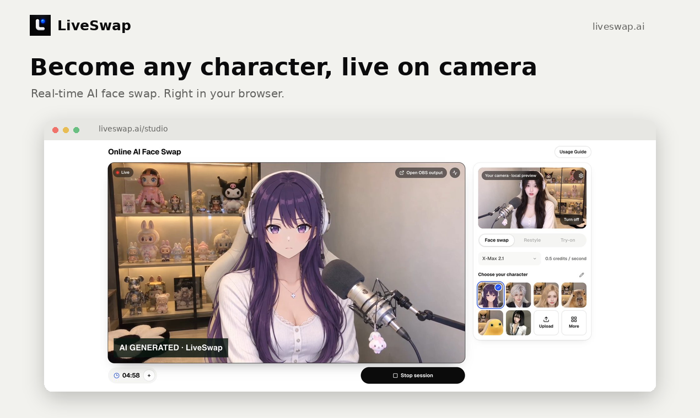
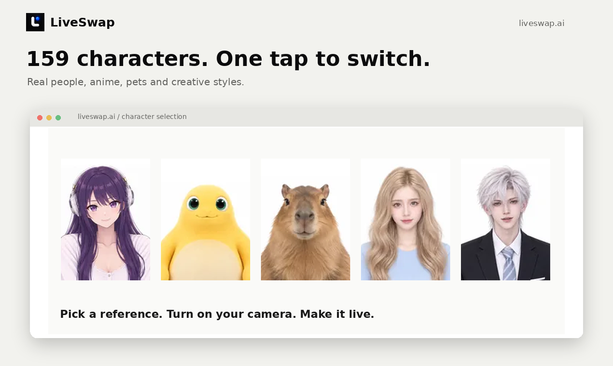
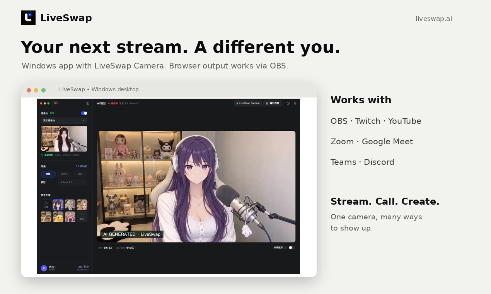

# LiveSwap — Real-Time AI Face Swap

[LiveSwap](https://liveswap.ai/) turns your webcam into a live AI character, right in your browser. Try real-time face swap, virtual try-on and style transfer without installing software.

**[Try the studio](https://liveswap.ai/studio) · [See pricing](https://liveswap.ai/pricing)**

## Features

- Live face swap, virtual try-on and style transfer in the browser.
- 159 characters: real people, anime, pets and creative styles, with one-tap switching.
- Webcam face swap output for streaming and video calls through OBS.
- Optional Windows desktop app with a **LiveSwap Camera** virtual camera. macOS is coming soon.
- 30 free credits for new accounts.

## How to use

1. Open the [LiveSwap studio](https://liveswap.ai/studio) and allow camera access.
2. Pick a character and choose face swap, virtual try-on or style transfer.
3. Start generation to see the AI output live.
4. For best results, stay alone in frame, face the camera and use even lighting.

## Use with OBS, Zoom, Meet, Teams and Discord

The browser does not install a system virtual camera. Capture the LiveSwap output window in OBS to stream to Twitch or YouTube. For calls, start **OBS Virtual Camera**, then select it as the camera in Zoom, Google Meet, Microsoft Teams or Discord.

Alternatively, the Windows desktop app installs **LiveSwap Camera**, which you can select directly in compatible apps.

## Pricing summary

New accounts receive **30 free credits**. Generation is charged per second:

| Model | Credits per second | Notes |
| --- | ---: | --- |
| X-Max 2.1 | 0.5 | Browser generation model |
| Lucy 2.6 | 3 | At least 30 credits to start; currently marked coming soon in the studio |

The pricing page currently says **Payments not yet open**. Check [current pricing and availability](https://liveswap.ai/pricing) before planning paid usage.

## FAQ

### Do I need to install anything?
No installation is needed for browser generation. OBS is needed to route browser output into streams or a virtual camera for calls. The Windows desktop app is optional.

### Does my camera stream stay on my device?
Camera preview stays local. Starting generation sends the reference and camera stream to the model provider. Do not assume generation happens entirely on your device.

### Is macOS supported?
You can use the browser workflow; the native macOS desktop app is coming soon.

### Is this the same as liveswap.io?
No. This repository introduces **LiveSwap.ai**, not liveswap.io.

### Is this the application source code?
No. This is a product overview and static landing page, not the LiveSwap application source code.

## Responsible use

Use only faces and references you have permission to use. Do not impersonate people, mislead viewers or create abusive content. Tell viewers when content is AI-generated. LiveSwap output is labeled **AI GENERATED · LiveSwap**.

## Links

- [LiveSwap website](https://liveswap.ai/)
- [Browser studio](https://liveswap.ai/studio)
- [Pricing and credit details](https://liveswap.ai/pricing)

Product details checked November 7, 2026. Features and availability may change.
